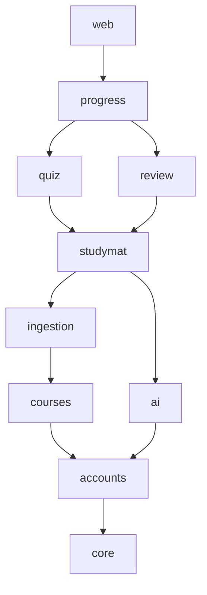
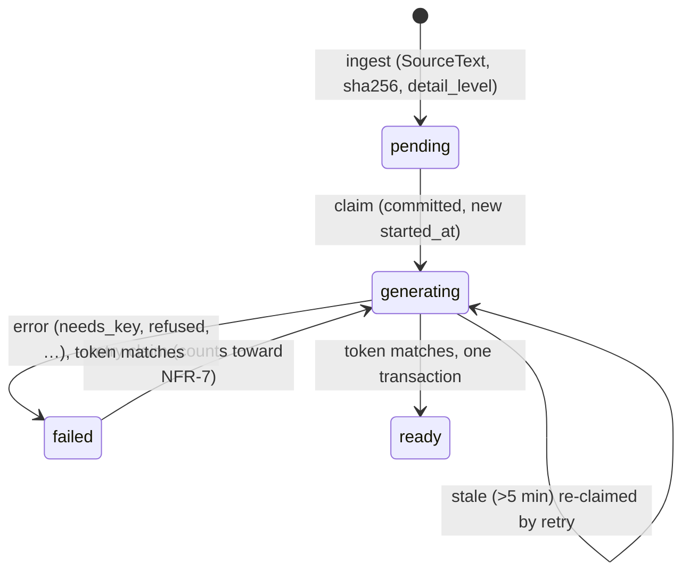
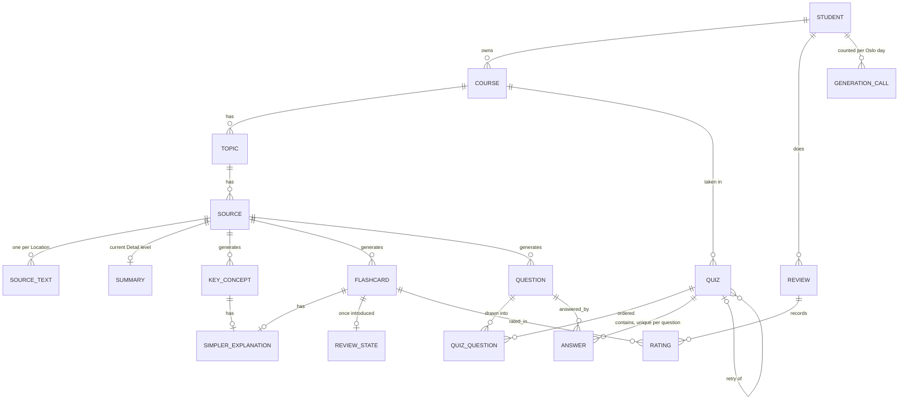
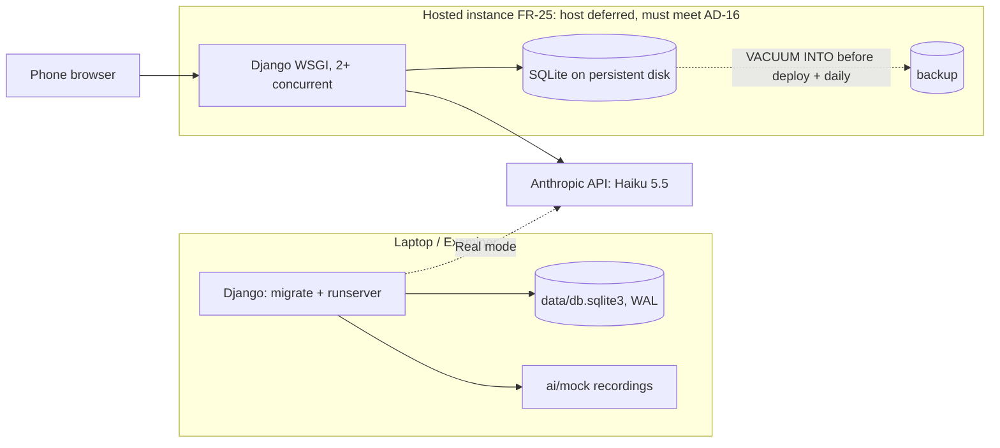

# Architecture Spine — AI Study Buddy v1

Terms follow the PRD glossary (§3) exactly. Surface names (P03, D05 and so on) follow EXPERIENCE.md.

## Design Paradigm

**Modular monolith.** One Django project and one SQLite database. Each Django app is a module that owns its models and exposes `services.py` (writes) and, where needed, `rules.py` (pure functions). Views are thin. **Ports and adapters at the AI edge:** `ai` is the single port to any language model, with a Mock adapter and an Anthropic adapter behind it.

| App | Owns | PRD |
| --- | --- | --- |
| `core` | Bottom layer: `time`, `ownership`, `messages` (error code → Norwegian text), `http` (Vary/HTMX helpers), template tags | — |
| `accounts` | `Student` (custom user model, `privacy_accepted_at`), sign-up gate | FR-1, FR-22, FR-25 |
| `courses` | Course, Topic, Source (status, failure reason, hashes, counts), `Scope`, `FailureReason` | FR-2, FR-9 |
| `ai` | Gateway (Mock or Anthropic), request/response schemas, Generation-call counter, mode | FR-6, FR-20, FR-21, FR-22, NFR-7 |
| `ingestion` | Upload limits, text extraction, `SourceText` (text per Location) | FR-3, FR-4, FR-5 |
| `studymat` | Summary, KeyConcept, Flashcard, Question, SimplerExplanation; generation orchestration; Reference check; dialogs D04 and D05 | FR-7, FR-8, FR-19, FR-24 |
| `quiz` | Quiz, QuizQuestion, Answer, Grade (+ override, weights), Retry round, Exam mode | FR-10 to FR-13, FR-18, FR-27 |
| `review` | ReviewState (Leitner), Due cards, Review, Rating | FR-14, FR-15 |
| `progress` | No models: Topic score, Course score, trend, Weak topics, Next step | FR-16, FR-17, FR-28 |
| `web` | Composite pages (Home P03, Course overview P04, Topic page P05), shell context, composite regions, 404 page | FR-23, FR-28 |

## Invariants & Rules



An arrow means "may import from", and reachability counts (`web` reaches everything; every app reaches `core`). `core` imports no app.

### AD-1 — Modules and dependency direction [ADOPTED]

- **Binds:** all apps
- **Prevents:** import cycles; one app writing another's tables; the AI provider leaking into feature code; "upward" reads that bypass imports.
- **Rule:**
  - **What may depend on what.** Apps depend only along the graph. The graph governs **model access**, not just `import` lines: reverse relations and attribute traversal such as `answer.question.source` count as access.
  - **Writes.** An app may read a reachable app's models. Writes go only through the owning app's `services.py`.
  - **The AI provider.** Only `ai` imports `anthropic`.
  - **Composite pages.** A page or region combining several apps (`band`, `tab-counts`, `forecast` on composite pages) is rendered only by `web`.
  - **Feature apps** own their own forms, dialogs and session pages.
  - **Signals stay downward.** A higher app may react to a lower app's changes with a signal receiver registered in its own `apps.ready()`; a lower app never imports the higher one.
  - **Shared types.** `courses.Scope` (`all`, `course_id` or `topic_id`) is the one scope type used by `review`, `progress` and `web`.

### AD-2 — One AI gateway, a closed set of operations, one schema contract [ADOPTED]

- **Binds:** FR-6, FR-7, FR-8, FR-12, FR-19, FR-20, FR-21, NFR-3; `ai`, `studymat`, `quiz`
- **Prevents:** ad hoc provider calls; free chat; Mock and real responses drifting; parsing refused, truncated or thinking-only output; grading that blows the 15 s budget.
- **Rule:**
  - **Operations.** `ai.gateway` exposes only `generate_study_material`, `regenerate_summary`, `grade_free_text` and `simpler_explanation`. Each takes `student` plus one request object from `ai/schemas.py` (for example `GenerateRequest(source_id, content_sha256, language, detail_level, locations)`). Callers build that object, so `ai` never touches a model above `accounts`.
  - **Choosing the provider.** No `ANTHROPIC_API_KEY` means Mock, always (FR-20). `AI_PROVIDER=mock` forces Mock even with a Key; test settings set it.
  - **Schemas.** Request and response schemas are Pydantic models. They carry no length or numeric constraints, no recursion and no confidence field, and no field is named `reasoning`. Enum values are exactly the stored values in Conventions, lower-cased before validation. Mock recordings validate against the same models.
  - **Anthropic adapter: request.** It uses structured output (`output_config.format`). It never uses Citations or PDF document blocks. It sets `output_config.effort` explicitly per operation (`low` for grading and Simpler explanations; generation is tuned in OQ-2) and sends no sampling parameters.
  - **Anthropic adapter: response.** It reads the text block by type. It accepts only `stop_reason == "end_turn"`: `refusal` becomes `Refused`, `max_tokens` or `model_context_window_exceeded` becomes `Truncated`, and anything else becomes `InvalidFormat`. `MAX_OUTPUT_TOKENS` leaves room for thinking.
  - **Timeouts.** `grade_free_text` uses `max_retries=0` and a timeout that keeps the total under 15 s, after which the Answer is `not_graded`. Generation stays inside AD-16's request floor.
  - **Errors.** Errors live in `ai/errors.py`, and each carries a `code` matching a `courses.FailureReason` value: `needs_key`, `privacy_not_accepted`, `daily_limit`, `rate_limited`, `refused`, `truncated`, `invalid_format`, `key_rejected`, `provider_unavailable`. `timed_out` is set by AD-5, not by an error.
  - **The Key** is never logged, rendered or sent to the browser.
  - **Read-only queries:** `mode()` and `remaining_today(student)`.

### AD-3 — The daily limit is counted in the database, per action [ADOPTED]

- **Binds:** NFR-7, FR-7, FR-9, FR-19, FR-20
- **Prevents:** counting API requests instead of actions; a count lost on restart or rolled back on failure; grading blocked mid-Quiz; Mock uploads using up the limit.
- **Rule:**
  - **What counts.** One Generation call is one Student action: generate a Source, retry, regenerate a Summary, or make any Simpler explanation (the first or a new one). Showing a saved Simpler explanation makes no call. `grade_free_text` never counts.
  - **Order of checks.** Every counted operation runs, in order:
    1. Mode: in Mock mode, a non-Sample Source or a Flashcard Simpler explanation raises `NeedsKey` and counts nothing.
    2. Privacy (AD-17).
    3. The counter, incremented by one conditional UPDATE that only succeeds below the limit, committed on its own (AD-19).
    4. Send.
  - **Failed attempts.** An attempt that fails after the send still counts. The limit applies in Mock mode too.

### AD-4 — Mock mode runs the real pipeline [ADOPTED]

- **Binds:** FR-7, FR-8, FR-12, FR-19, FR-20, NFR-2, NFR-5
- **Prevents:** a faked Reference check; an Examiner path unlike Real mode; recordings that leak a Key or lose the planted error.
- **Rule:**
  - **Recognising the Sample document.** It matches on `Source.content_sha256`, which `ingestion` sets at upload (AD-5).
  - **Recordings.** They live in `ai/mock/`: Study material, a Summary at each Detail level, and Simpler explanations keyed by the normalised Key-concept term. They pass the **same** validation, length checks and Reference check as real responses. Exactly one recorded item has a wrong page index, so the real check removes it.
  - **Writing recordings.** Only `manage.py record_mock` writes them. It strips headers and Keys and re-plants the wrong-page item. Re-record when a prompt or schema changes.
  - **Mock grading.** A Free-text Grade uses a fixed word-overlap rule with `is_mock` set.

### AD-5 — Generation lifecycle: two steps, one claim, all or nothing [ADOPTED]

- **Binds:** FR-3, FR-7, FR-8, FR-9, FR-23, FR-26
- **Prevents:** half-saved Study material; a second paid call from a reload or second tab; a Source stuck generating or impossible to retry; a late run overwriting a newer one; a failed Summary regeneration wiping a ready Source.
- **Rule:**
  - **Step 1, upload (D05, in `studymat`).** It calls `ingestion.services.ingest()`. That validates the file, stores the `SourceText` rows, and creates the Source as `pending` with `content_sha256` (of the file bytes, or of UTF-8 for pasted text), `detail_level` and `started_at`. The file itself is not kept.
  - **Step 2, `POST generate`.** It claims the Source through `Source.objects.claimable()`: `pending`, `failed`, or `generating` older than 5 min. The claim is one committed conditional UPDATE that sets `generating` and a fresh `started_at`, which is returned as the run token. If nothing is claimed, the request is refused.
  - **Running and saving.** The orchestrator `studymat.services.generate()` runs the gateway, validation and the Reference check. It then saves all Study material and sets `ready` in one transaction that first matches `status = generating AND started_at = token`. If that doesn't match, it saves nothing.
  - **Failing.** On any error it writes `failed` plus `failure_reason`, under the same token condition. `needs_key` is set only here.
  - **Reading and changing status.** Only `courses.services` changes status. Everyone reads `Source.effective_status`, which uses the same 5-minute predicate as `claimable()`. Under it, `pending` shows as generating, and a stale run shows as `failed` with `timed_out`.
  - **Leaving the page** never cancels a run.
  - **Regenerating a Summary** never touches Source status. Success replaces the one Summary row; failure keeps the old one.
  - **Retry** reuses `SourceText` and `detail_level`.



### AD-6 — Location, Reference and the item checks [ADOPTED]

- **Binds:** FR-3, FR-4, FR-5, FR-6, FR-7, FR-8, FR-19, FR-23
- **Prevents:** competing Location shapes; checking text other than what the model saw; valid quotes failing on extraction artefacts; length failures polluting the FR-8 count.
- **Rule:**
  - **Storing text.** `SourceText(kind, index, label, text)`: `kind` is `page`, `paragraph` or `heading`; `index` starts at 1. A PDF gets one row per viewer page, empty pages included. A PDF with less than `MIN_TEXT_CHARS` in total is rejected as scanned.
  - **Markers.** Only non-empty rows get a marker; the marker format is fixed in `ai`.
  - **References.** An item's Reference is `location_index` + `quote`.
  - **The Reference check.** It strips markers and normalises both sides the same way (NFKC, whitespace, line breaks, hyphenation, quotes and dashes folded, case-insensitive). It passes when the quote is at least 5 words, occurs in that Location, and is not repeated on most non-empty Locations.
  - **Counting removals.** Reference failures are not saved and are counted in `Source.removed_count`. Length or structure failures (FR-7) are dropped and counted in `Source.dropped_count`.
  - **Language.** It is returned by generation and stored as `Source.language`.
  - **Reusing References.** Explanations and Simpler explanations reuse their item's Reference.
  - **Display.** A Reference is always shown with `components/reference.html`, through one `studymat` helper that resolves `(source, location_index)` to a kind and label.

### AD-7 — Ownership: one user model, a `student` on every row, 404 for everything else [ADOPTED]

- **Binds:** FR-1, FR-22, FR-25, NFR-4; every Student-owned model
- **Prevents:** an unscoped `get(pk=…)` leaking data; a 403 that reveals existence; a user-model swap after the first migration; duplicate accounts that differ by case; the login page swapped into a region.
- **Rule:**
  - **User model.** `accounts.Student` is the custom `AUTH_USER_MODEL` from the first migration. Its `email` is the `USERNAME_FIELD`, lower-cased on save, unique under a `Lower("email")` constraint, and looked up case-insensitively. Privacy acceptance is `Student.privacy_accepted_at`, written only by `accounts.services.accept_privacy()`.
  - **Sign-in required.** `LoginRequiredMiddleware` is on, and the sign-up view carries `@login_not_required`. An unauthenticated HTMX request gets `HX-Redirect` to sign-in.
  - **The `student` field.** Every owned model has a non-null `student` FK. Services set it from the parent explicitly, `bulk_create` included, and one test per model checks that it equals the parent's.
  - **Loading objects.** Views load owned objects only through `core.ownership.get_owned_or_404()` or `Model.objects.for_student(user)`. Anything not the Student's returns **404**.

### AD-8 — Hard delete with cascade [ADOPTED]

- **Binds:** FR-2, FR-16, FR-24, FR-27
- **Prevents:** soft-delete flags that queries forget; empty Quizzes nobody may delete.
- **Rule:** Deletion removes rows. Ownership chains use `on_delete=CASCADE` (Course → Topic → Source → everything under it). Nothing has a `deleted` flag. `parent_quiz` uses `SET_NULL`. `quiz` deletes a Quiz when its last QuizQuestion goes, through a `post_delete` receiver in `quiz`. History and result code still guard `total == 0`.

### AD-9 — Quiz, Question and Answer: shapes, timing, the effective Grade [ADOPTED]

- **Binds:** FR-10 to FR-13, FR-16 to FR-18, FR-24, FR-27, NFR-5; `studymat`, `quiz`, `ai`
- **Prevents:** consumers disagreeing on which Grade counts or on ordering; overwriting the AI provider's Grade; Quizzes that break on reload, deletion or timeout; running exams leaking into scores.
- **Rule:**
  - **Question.** `kind` (`multiple_choice` or `free_text`), `prompt`, `hint`, `options` (JSON, four `{text, explanation}`), `correct_index`, `model_answer`, Reference.
  - **Quiz.** `course`, `kind` (`practice`, `retry` or `exam`), `started_at`, `return_url`, `parent_quiz`, and for exam `time_limit` and `submitted_at`. `QuizQuestion(quiz, question, position)` is fixed at start, and totals count QuizQuestions. A Topic's history lists every Quiz with a QuizQuestion in it, and an Answer's Topic is `question.source.topic`. Starting a Retry round reuses an unanswered Retry round of the same parent; its members are the parent's Questions whose effective Grade is `incorrect` or `partial`.
  - **Answer.** Unique on `(quiz, question)`, where the Question must be a QuizQuestion of that Quiz, or the request gets 404. Fields: `chosen_index` or `text`, `grade` (null = pending), `override_grade`, `explanation`, `is_mock`, and `answered_at` (set once, never changed). **Consumers use only `Answer.objects.with_effective_grade()`** (`Coalesce(override_grade, grade)`); filtering on `grade` directly is forbidden. "Most recent" means `answered_at` descending, then `id`.
  - **Saving an Answer.** `quiz.services.save_answer`: in practice and retry, the first write wins and the Answer is graded at once (Multiple-choice in code). In an exam, it is an upsert while `Quiz.effective_submitted_at` is null. That property is `submitted_at`, or `started_at + time_limit` once passed, and is read like `effective_status`. `submit()`, or the first read after the deadline, grades Multiple-choice Answers in code. Free-text cells on the result page each send one grading POST.
  - **Grade weights** (1, 0.5, 0) live in `quiz/rules.py`.

### AD-10 — Progress is computed on read, never stored [ADOPTED]

- **Binds:** FR-16, FR-17, FR-28, SM-1, SM-4
- **Prevents:** stale or double-counted scores; every page building its own band; band buttons that hit mutating endpoints.
- **Rule:**
  - **Nothing stored.** `progress` has no models.
  - **Topic score.** It uses `quiz.rules` weights on the 20 most recent Answers in the Topic. It counts only Answers whose effective Grade is not null or `not_graded`, whose Quiz is not a `retry`, and, for an exam, whose Quiz has `effective_submitted_at`. Window, minimum, threshold and minute estimates are constants in `progress/rules.py`.
  - **Trend.** The Topic score before versus after the latest non-retry Quiz with Answers in that Topic.
  - **Next step.** `progress.next_step(student, scope)` returns `NextStep(size, unit, heading, why, button_label, url, minutes)`, `Calm(text)` or `None`, rendered by `components/next_step_band.html`. `url` always points to a GET page or dialog, never to a mutating endpoint.

### AD-11 — Spaced repetition: Leitner, one definition of Due [ADOPTED]

- **Binds:** FR-14, FR-15, FR-23, FR-28, SM-1
- **Prevents:** a second scheduler; browsing changing dates; pages counting Due cards differently; a Topic Review taking the day's new cards; a double tap moving a card two boxes.
- **Rule:**
  - **Boxes and ratings.** Intervals are `1, 3, 7, 14, 30, 60, 120, 180` days. *Good* moves a card up 1 box, *Easy* up 2, *Hard* keeps it, and *Again* sends it to box 1 and back into the open Review. The pure function `review.rules.next_due(state, rating, today)` is used both for writing and for the four previews.
  - **New cards.** A Flashcard with no `ReviewState` row is new.
  - **Writers.** `review.services` has exactly two:
    - `introduce_today(student)`: idempotent per Oslo day. It creates rows (box 1, `due_date` today, `introduced_on` today) for up to `20 − already introduced today` new cards, across all Courses, in generation order.
    - `rate(review, flashcard, rating, step)`: a no-op if that `step` is already rated.
  - **Due cards.** `due_cards(student, scope)` calls `introduce_today()` first, then filters by scope; scope never changes which cards are introduced. It is the only definition of Due cards.
  - **Reviews.** Stored as `Review(student, scope, started_at, ended_at, return_url)` with one `Rating(review, flashcard, rating, step, rated_at)` per press. Browsing never writes.

### AD-12 — Time: store UTC, count days in Oslo [ADOPTED]

- **Binds:** NFR-7, FR-15, FR-16, FR-18, FR-28
- **Prevents:** a Review at 00:30 landing on the wrong day; the limit resetting at 01:00 or 02:00 Oslo time.
- **Rule:** `USE_TZ = True` and `TIME_ZONE = "Europe/Oslo"`. Datetimes are stored in UTC. Every "today" comes from `core.time.today()` (the Oslo date) and every "now" from `core.time.now()`. Tests freeze both.

### AD-13 — Rendering contract: full pages, HTMX fragments, no JavaScript build [ADOPTED]

- **Binds:** NFR-1, NFR-2, NFR-6, FR-23 and every surface
- **Prevents:** a creeping SPA; pages that break on reload or Back; a cached fragment served as a page; double-bound scripts; a Node toolchain for the Examiner.
- **Rule:**
  - **Full pages.** Every URL renders a full page.
  - **Partials.** A view returns a named `` partial, chosen by `request.htmx.target`, only for an HTMX request that is not a history restore. It sends `Vary: HX-Request, HX-Target, HX-History-Restore-Request` (the `core.http` decorator). htmx runs with `historyRestoreAsHxRequest: false`.
  - **Titles.** A partial that changes the URL emits `<title>` as its first top-level node; other partials emit none.
  - **No lazy loading.** Pages render complete, with no lazy sections or skeletons. The one exception is a pending-Grade cell, which may send one POST with `hx-trigger="load"`.
  - **Client code.** It is vendored htmx 2.0 plus one `static/js/app.js`, both loaded in `<head>` with `defer`. `app.js` binds only delegated listeners on `document`. Nothing is built or bundled.
  - **CSRF.** The token is sent through `hx-headers` on `<body>`.
  - **Language.** Norwegian bokmål text lives only in templates and `core/messages.py`. Identifiers, models and URLs are English and use PRD glossary terms.

### AD-14 — Configuration from the environment, zero-config start [ADOPTED]

- **Binds:** FR-20, FR-21, FR-25, NFR-2, NFR-4
- **Prevents:** settings that differ in code between laptop and Hosted instance; an Examiner blocked by a missing secret; an insecure Hosted instance.
- **Rule:**
  - **Source of settings.** Every setting comes from environment variables, loaded from `.env` by python-dotenv. `.env` and `data/` are git-ignored. `.env.example` lists every variable, with no secret filled in.
  - **Empty `.env`.** The app starts in Mock mode, on SQLite at `DATA_DIR/db.sqlite3`, with `DATA_DIR` created on start.
  - **Non-local environments.** When `APP_ENV` is not `local`, the app refuses to start unless all of these hold: a non-default `SECRET_KEY`; `DEBUG` off; `ALLOWED_HOSTS` and `CSRF_TRUSTED_ORIGINS` set; secure session and CSRF cookies; the admin disabled.
  - **Closed sign-up.** `SIGNUP_ALLOWED_EMAILS` closes sign-up to the listed addresses.

### AD-15 — Key-free tests by FR; Real-mode checks recorded [ADOPTED]

- **Binds:** NFR-5, NFR-3, SM-3, every FR with Key-free consequences
- **Prevents:** tests that need a Key, the network or the Author's machine; AD-1 eroding unnoticed; Real-mode claims with no record.
- **Rule:**
  - **Test setup.** pytest-django with `AI_PROVIDER=mock`, frozen `core.time`, and sockets disabled by pytest-socket.
  - **Coverage.** Each Key-free testable consequence has a test named after its FR (`test_fr15_good_interval_grows`). One test enforces the AD-1 import graph. The README gives one command for all of them.
  - **Real-mode checks.** The extraction test, the NFR-5 content check, the NFR-3 timings (including a cold-schema first call) and SM-3 are written to `docs/quality/`.

### AD-16 — Operating envelope: one app, one database file [ADOPTED]

- **Binds:** NFR-2, NFR-3, FR-9, FR-25
- **Prevents:** a broken first run; a host that breaks in-request generation or loses data; unsafe backups.
- **Rule:**
  - **Locally.** `uv sync`, then `uv run manage.py migrate`, then `uv run manage.py runserver`. No Docker and no Node.
  - **Host requirements.** A Hosted instance must provide:
    - a persistent disk for `DATA_DIR`;
    - SQLite 3.37 or newer;
    - a request timeout of at least 150 s;
    - at least 2 concurrent requests;
    - outbound HTTPS to `api.anthropic.com`;
    - configuration through environment variables;
    - a cost of zero.
  - **Deploying.** Every deploy runs a backup with `VACUUM INTO`, then `migrate`, then a reload. A daily backup runs too. A live file copy is never used as a backup.

### AD-17 — Privacy acceptance is enforced at the gateway [ADOPTED]

- **Binds:** FR-22, FR-12, FR-19, NFR-4
- **Prevents:** Source text reaching the AI provider by a path that skips the upload screen: a retry after switching to Real mode, grading, or a Simpler explanation.
- **Rule:** In Real mode, `ai.gateway` raises `PrivacyNotAccepted` for any operation carrying Source text when `privacy_accepted_at` is null. The notice is shown by D04 (in `studymat`) before D05, and is not shown in Mock mode. The gateway is the guard.

### AD-18 — Interaction mechanics shared by every surface [ADOPTED]

- **Binds:** every surface in EXPERIENCE.md; FR-9, FR-10, FR-15, FR-18, FR-24
- **Prevents:** competing refresh styles; native confirm boxes; errors htmx drops; double submits; lost focus; open redirects.
- **Rule:**
  - **After a mutating POST.** It answers with `HX-Location` back to its page (the default), or with one named region plus listed out-of-band regions that its own app can render. Composite regions come only from `web` (AD-1). It never shows a success toast.
  - **Dialogs.** A dialog is a GET URL: a standalone page normally, and under HTMX a `<dialog>` partial in the one `#dialog` slot, opened and closed by `app.js`. A valid submit answers with `HX-Location`; an invalid one re-renders the dialog. `hx-confirm` is not used.
  - **Expected failures** return `components/inline_message.html` with status 200, keyed by error `code`. `app.js` handles `htmx:sendError` and `htmx:responseError` with a fixed inline message.
  - **Repeat presses.** Mutating controls set `hx-disabled-elt="this"`, plus `hx-sync="closest form:drop"` inside forms and `hx-sync="this:drop"` otherwise. On the server, `generate`, `rate`, `save_answer` and Quiz start are idempotent (AD-5, AD-9, AD-11). A cross-tab double regeneration of a Summary or Simpler explanation is accepted, because it costs one extra call.
  - **Focus and announcements.** Swapped content marks its focus target with `autofocus`. The permanent regions `#live-polite` and `#live-assertive` are filled only through out-of-band swaps of their contents.
  - **Leaving a session.** Exit links go to the stored `return_url`: a relative path checked with `url_has_allowed_host_and_scheme`, with any query string kept. They never use the Referer.
  - **Keys and menus.** Keys are declared as `data-key` and bound only by `app.js`. Menus use the native `popover` attribute.
  - **Upload checks.** The browser checks only file size and type; the server enforces the page limit and keeps nothing it rejects. The exam clock in the browser only displays the time.

### AD-19 — Transaction boundaries around the paid call [ADOPTED]

- **Binds:** NFR-7, FR-9, FR-12, FR-19, AD-3, AD-5, AD-16
- **Prevents:** a failed attempt rolling back its counter; a claim invisible to a second tab; SQLite write-locked for the length of a provider call; two increments racing past the limit.
- **Rule:**
  - **No transaction around the call.** `ATOMIC_REQUESTS` is off. **No gateway call runs inside a transaction**, and the gateway asserts `not connection.in_atomic_block`.
  - **Separate commits.** The claim (AD-5) and the counter increment (AD-3) each commit on their own before the send. Only the final save is atomic. The failure write is a separate commit.
  - **SQLite settings.** WAL, `transaction_mode: "IMMEDIATE"`, and a busy timeout of at least 5 s.

## Consistency Conventions

| Concern | Convention |
| --- | --- |
| Naming | Models and code use PRD glossary terms in English. URL names follow `<app>:<action>`. |
| URLs and IDs | `/<plural-noun>/<id>/…` with English query keys, for example `/topics/12/?tab=summary` with tab values `summary`, `quiz`, `selftest` and `sources`. No slugs. IDs are default `BigAutoField` integers, which are safe because of AD-7. |
| Enums | `TextChoices` with lowercase values: `pending/generating/ready/failed`, `correct/partial/incorrect/not_graded`, `practice/retry/exam`, `again/hard/good/easy`, `page/paragraph/heading`, `multiple_choice/free_text`, `short/medium/detailed`, and `FailureReason` (AD-2 codes plus `timed_out`). Services assert values before saving. |
| Templates | Layouts are `layouts/shell.html`, `layouts/session.html` and `layouts/auth.html`; a custom `handler404` renders the P12 page in the shell. Pages are `<app>/<page>.html`. Shared components are `templates/components/<design-name>.html`, used with `` and never redefined per app. Icons come from `static/icons/sprite.svg` through ``. |
| CSS and theme | `static/css/tokens.css` holds every DESIGN.md token as `--<name>`: light on `:root`, and the same names redefined under `prefers-color-scheme: dark` and `[data-theme=dark]` (never `--<name>-dark`). Component classes are `.<design-name>` in `static/css/components.css`. The theme override is a `theme` cookie only, rendered server-side as `<html data-theme>`. Public Sans is vendored. |
| Errors to the Student | Typed errors carry a `code`. `core/messages.py` is a plain dict from `code` to Norwegian text. Views never write error text inline. |
| Logging | `logging` to stdout. Never the Key, passwords or Source text. Gateway calls are logged with Student id, operation and outcome. |
| Simpler explanation | One model with exactly one of `key_concept` or `flashcard` set, unique per item, replaced when a new one is made. |
| Limits and constants | The PRD §10 numbers are module constants with their PRD reference. Length rules (FR-7, FR-19) are checked in code after validation, never in provider schemas. `ai` defines `MAX_OUTPUT_TOKENS` and an input ceiling below 100k tokens. |

## Stack

| Name | Version |
| --- | --- |
| Python | 3.13 (Django requires ≥ 3.12) |
| uv | ≥ 0.12 (latest 0.13.8) |
| Django | 6.1.3 |
| django-htmx | 1.29.0 |
| htmx (vendored file, not ``) | 2.0.11 |
| anthropic (Python SDK) | 2.8.0 |
| pydantic (direct dependency) | 2.14.3 |
| Claude model | Claude Haiku 5.5, `claude-haiku-5-5` |
| pypdf | 7.0.1 `[PROVISIONAL]`: locked only after OQ-1 |
| python-dotenv | 1.2.4 |
| pytest-django | 4.14.0 (lists Django 6.0; 6.1 support is merged for 4.15) |
| pytest-socket | 0.8.1 |
| SQLite | ≥ 3.37 (bundled with Python; 3.50 locally) |

## Structural Seed

```text
G49-braten/
  manage.py, pyproject.toml, uv.lock, .env.example
  config/                 # settings.py (env), urls.py, wsgi.py
  core/                   # time, ownership, messages, http, templatetags
  accounts/ courses/ ai/ ingestion/ studymat/ quiz/ review/ progress/ web/
  ai/mock/                # recordings (written by record_mock)
  sample/                 # copyright-free Sample document
  templates/layouts/ templates/components/
  static/css/ static/js/ static/icons/ static/fonts/
  data/                   # db.sqlite3 (git-ignored)
  docs/quality/           # extraction test, content check, timings
  tests/                  # pytest-django, named by FR; import-graph test
```





## Capability → Architecture Map

| Capability / Area | Lives in | Governed by |
| --- | --- | --- |
| FR-1 Sign-up/sign-in | `accounts` | AD-7, AD-14 |
| FR-2 Courses, Topics, Sources | `courses`, pages in `web` | AD-7, AD-8 |
| FR-3, FR-4 Upload, Location | `studymat` (D05) → `ingestion` | AD-5, AD-6, AD-18 |
| FR-5 Word (Should) | `ingestion` | AD-6 |
| FR-6 Source language | `ai`, `Source.language` | AD-2, AD-6 |
| FR-7, FR-8 Generate + check | `studymat` → `ai` | AD-2 to AD-6, AD-19 |
| FR-9 Status, failure, retry | `courses` status, `studymat` orchestrator | AD-5, AD-19 |
| FR-10 to FR-13, FR-27 Quiz | `quiz` | AD-9, AD-18 |
| FR-12 Free-text grading | `quiz` → `ai` | AD-2, AD-9, AD-17 |
| FR-14, FR-15 Flashcards, Review | `review` | AD-11, AD-12 |
| FR-16, FR-17, FR-28 Scores, Next step | `progress`, rendered by `web` | AD-10, AD-11 |
| FR-18 Exam mode (Should) | `quiz` | AD-9, AD-13, AD-18 |
| FR-19 Simpler explanation (Should) | `studymat` → `ai` | AD-2, AD-3, AD-6, AD-17 |
| FR-20, FR-21 Mock/Real mode | `ai` | AD-2, AD-4, AD-14 |
| FR-22 Privacy notice | `studymat` (D04), `accounts`, enforced in `ai` | AD-17 |
| FR-23 View Study material | `web` (Topic page), `studymat` | AD-13, AD-18 |
| FR-24 Delete an item | `studymat` | AD-8, AD-18 |
| FR-25 Hosted instance (Should) | deployment | AD-14, AD-16 |
| FR-26 Background generation (Should) | `studymat` | AD-5, AD-19 |
| NFR-1, NFR-6 Responsive, Norwegian | templates, `static/css` | AD-13, Conventions |
| NFR-2 Run from README | repo root | AD-14, AD-16 |
| NFR-3 Response times | `ai` timeouts | AD-2, AD-16, OQ-2 |
| NFR-4 Security | all | AD-2, AD-7, AD-14, AD-17 |
| NFR-5 Testability | `tests`, `docs/quality` | AD-15 |
| NFR-7 Daily limit | `ai` | AD-3, AD-12, AD-19 |

## Open Questions

| # | Question | Owner | Needed by |
| --- | --- | --- | --- |
| OQ-1 | NFR-5 extraction test on 3 of the Author's slide decks: pypdf 7.0.1 in plain and in layout mode, against pdfplumber, plus a read of the pypdf 7.0 changelog. Settles the library, the mode and `MIN_TEXT_CHARS`, and is written to `docs/quality/`. | Author | Before step 1 is done (20 Nov) |
| OQ-2 | Real-mode generation time for 20- and 50-page PDFs, with a cold-schema first call and the chosen effort level, plus the Author's Anthropic rate-limit tier against a 50-page prompt. If generation nears 150 s or hits the limit, lower the FR-3 limits or pull FR-26 forward. | Author | Before step 1 is done |
| OQ-3 | Host checks for FR-25 against AD-16 (PythonAnywhere free): is `api.anthropic.com` on the allowlist; what are the request timeout, the concurrency and the SQLite version; can it run a scheduled backup, and, if FR-26 is taken, a long-running worker? | Author | When FR-25 starts |

## Deferred

- **Host for the Hosted instance (FR-25).** Chosen when FR-25 starts; it must meet AD-16 (OQ-3). The candidate is PythonAnywhere free. Static-file serving is settled together with the host. If no zero-cost host meets AD-16, FR-25 is dropped from v1 (Author, 2026-11-14), with no architecture change.
- **Background generation (FR-26).** Expected route: Django's `django.tasks` with the third-party `django-tasks-db` backend and a `db_worker` process. Check its Django 6.1 support and the host's worker support when FR-26 starts. The worker performs the AD-5 claim, and the source row polls its own URL every 5 s while it is generating.
- **Prompt design.** Inside `ai`. v1 sends one request per Generation call; a Source is split only if OQ-2 or output quality requires it.
- **Word extraction library (FR-5, Should).** Chosen when FR-5 starts; AD-6 already fixes `heading` and `label`.
- **Tuning the starting values** in PRD §10, including the FR-3 limits after OQ-1 and OQ-2. These are constants, so no architecture change is needed.
- **Extra providers.** Ollama and Gemini are rejected for v1: FR-21 picks Haiku, Gemini's free tier uses submitted content, and Ollama's default context is 4k.
- **Recheck before delivery (7 Dec).** Haiku 5.5's price and structured-output behaviour, plus a pytest-django release with official Django 6.1 support.
